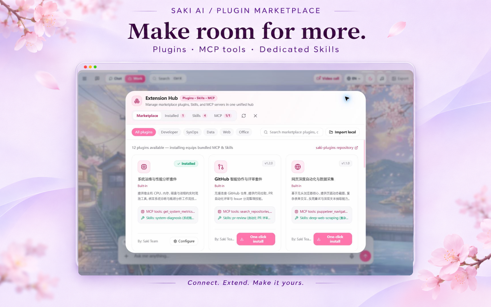
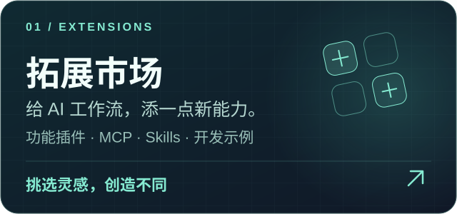
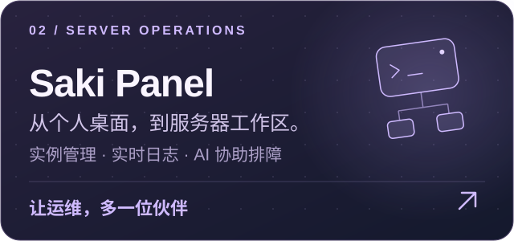

<div align="center">

# Saki AI
### Open-source, local-first AI agent workspace for code, files, research, and daily work

Multi-Model GUI · File & Terminal Agent · Git-free Checkpoints · MCP & Skills

[English](README.md) · [简体中文](README.zh-CN.md)

</div>

<div align="center">

[](https://nodejs.org/)
[](https://reactjs.org/)
[](https://vitejs.dev/)
[](https://tailwindcss.com/)
[](https://expressjs.com/)
[](LICENSE)
[](#contributing)

</div>

**Saki AI is an open-source, local-first AI workspace that runs on your machine.** Connect local models (Ollama, LM Studio) or cloud APIs (OpenAI, Claude, Gemini, DeepSeek, Qwen, etc.) in one GUI, and let the agent edit code, manage workspace files, run terminal commands, conduct deep research, and generate documents or slides.

Inspired by task-driven coding agents like **Claude Code and Codex**, Saki focuses on giving you a **model-agnostic visual workspace that goes beyond coding**—with automatic per-turn file snapshots (roll back anytime without Git), long-term memory, MCP/plugin extensions, and live voice/video calls.

**[Download Windows Portable](https://github.com/EthanChan050430/Saki-AI/releases/latest)** · [Quick Start](#quick-start) · [Low-resource Deployment](docs/deployment.md) · [Plugins](docs/plugin-marketplace.md)

https://github.com/user-attachments/assets/296a2a45-9590-4b40-84da-655930a4de1a

## Preview

**Multi-model workspace**: read and edit local files, run terminal commands, inspect diffs, and keep long-term memory across sessions.


**Plugin marketplace & MCP extensions**: install plugins, MCP tools, and custom Skills in one click.



**Live character video calls**: voice conversation with real-time captions and optional camera input.


## Ecosystem & Related Projects

<table>
  <tr>
    <td width="50%" valign="top">
      <a href="https://github.com/EthanChan050430/saki-plugins"></a>
      <p>Install plugins straight from Saki's built-in marketplace, or build your own plugins and Skills starting from the examples.</p>
      <p><a href="https://github.com/EthanChan050430/saki-plugins"><strong>Browse saki-plugins ↗</strong></a></p>
    </td>
    <td width="50%" valign="top">
      <a href="https://github.com/EthanChan050430/Saki-Panel"></a>
      <p>Open-source server panel with an AI assistant. Manage Minecraft, Steam, Docker, and regular processes in one web console, with AI troubleshooting backed by logs and node metrics.</p>
      <p><a href="https://github.com/EthanChan050430/Saki-Panel"><strong>Meet Saki Panel ↗</strong></a></p>
    </td>
  </tr>
</table>

## What it does

- **Any model**: Ollama, LM Studio, OpenAI, Anthropic, Gemini, DeepSeek, Zhipu, Kimi, Qwen, Doubao, MiniMax, or any OpenAI-compatible endpoint. Keys are stored per provider; switch models from the top bar.
- **Real work in your repo**: reads and edits files, runs terminal commands, and shows every tool call and diff.
- **Undo anything in the workspace**: each turn snapshots the workspace before the agent starts, including changes made from the terminal. Jump back to any turn. No Git required.
- **Steer while it runs**: add instructions mid-task, queue follow-ups, edit or cancel them.
- **Video calls**: talk with Saki through a live character, voice, captions and optional camera input. See the [video call guide](docs/video-call.md).
- **Long-term memory**: preferences and project rules carry across sessions.
- **Beyond code**: PDF / Office Q&A, multi-source deep research, PPT generation and export, claim checking.
- **Story Glass**: tell Saki a story and she mixes a cocktail for it, served as a shareable card.
- **Extensible**: MCP, Skills, and a plugin marketplace. Optional QQ bot, Stable Diffusion and GPT-SoVITS voice.
- **Lightweight**: runs as a single-process, single-port local web service with data stored in local JSON files (no database needed). The Windows portable build bundles Node.js and opens straight in your browser.

## Quick Start

**Windows portable**: download `Saki-AI-3.0-win-x64.zip`, unzip, run `Saki-AI.exe`. Your browser opens http://127.0.0.1:5480. Add a model in Settings and you're set. Node.js is bundled.

**From source** (Windows / macOS / Linux, Node.js 22.12+):

```bash
git clone https://github.com/EthanChan050430/Saki-AI.git
cd Saki-AI
node scripts/launch.cjs
```

The first launch installs dependencies and builds the frontend. On macOS / Linux, `bash deploy.sh start` runs it in the background. For low-spec machines, see the [deployment guide](docs/deployment.md).

## Heads up

Approvals and path checks are app-level guards, not an OS sandbox. Terminal commands and third-party plugins run with your user's permissions, so only grant the folders you need. Checkpoints restore workspace files only; requests and messages already sent can't be undone.

## Contributing

Issues and PRs welcome. Licensed under [Apache 2.0](LICENSE).
