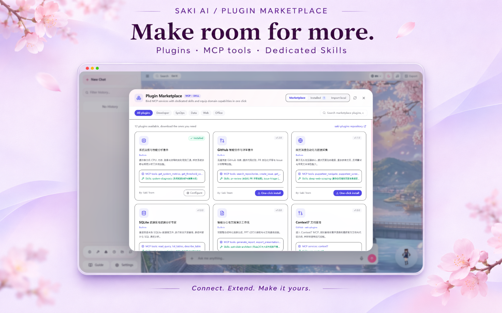
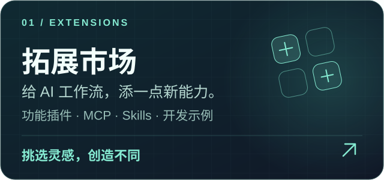
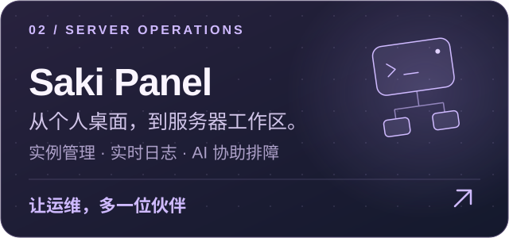

<div align="center">

# Saki AI Agent
### Local-first AI workspace for code, files, research and long-term collaboration

Local-first AI Workspace · Model Choice · Recoverable Workflows · Beyond Coding

[English](README.md) · [简体中文](README.zh-CN.md)

</div>

<div align="center">

[](https://nodejs.org/)
[](https://reactjs.org/)
[](https://vitejs.dev/)
[](https://tailwindcss.com/)
[](https://expressjs.com/)
[](LICENSE)
[](#contributing)

</div>

**Saki AI is a local-first AI workspace built for Chinese-speaking users.** Connect local or cloud models in one GUI, let the agent work on your code, workspace files and terminal tasks, and bring research, documents, slides, long-term memory and QQ workflows into your daily work.

Saki takes the task-driven collaboration of coding agents like **Codex and Claude Code** as its reference point. It does not claim to out-code them. The goal is a **personal AI workspace that isn't locked to one model, covers more than coding, and lets you manage and roll back tasks on your own machine**. The UI is served by a local web service; the Windows portable build launches it from an EXE and opens your browser. It is not a native desktop GUI.

**[Download Windows Portable](https://github.com/EthanChan050430/Saki-AI/releases/latest)** · [Quick Start](#quick-start) · [Low-resource Deployment](docs/deployment.md) · [Plugins](docs/plugin-marketplace.md)

> **Keywords**: Desktop AI Agent · Coding Agent · Local-first · Ollama / LM Studio · MCP · Workspace Checkpoints · Long-term Memory · Research & Office


https://github.com/user-attachments/assets/91ac7121-2a01-4751-a0c3-bc257e097b0e

## Feishu and Telegram

Open **Third-party Chat**, select Feishu or Telegram, enter credentials, and save with the channel enabled. Both support text in direct messages and group mentions, use the current web model, and save conversations in web history. Commands: `/new`, `/deep question`, `/ppt topic`, and `/model` (shows the current model; change it in web settings). Images, audio and file inputs are not supported yet; generated files are available in the web app.

- **Telegram**: Create a bot with `@BotFather` and enter its Bot Token. Long polling needs access to `api.telegram.org`, without a public callback. Remove any existing webhook first, and run only one polling instance per bot. Mention the bot in groups or use `/new@bot_username`. Forum topics have separate conversations.
- **Feishu**: Create an internal application, enable its bot, grant `im:message:send_as_bot` and the required receive permissions (for example `im:message.p2p_msg:readonly` and `im:message.group_at_msg:readonly`), subscribe to `im.message.receive_v1`, and publish the app. Enter App ID, App Secret and Verification Token. Use a Webhook callback at `https://your-domain/api/integrations/chat/feishu/events` with Encrypt Key disabled. Group mentions also require the bot's Open ID in settings.

Allowed user IDs are comma separated; empty allows everyone. Telegram uses numeric user IDs and Feishu uses user Open IDs. Enabled channels start after saving and restart with the server; QQ keeps its existing connection behavior. Feishu connection status validates credentials; delivery also depends on permissions, publishing and callback setup. Events are acknowledged immediately and processed in the background, with in-memory deduplication for ten minutes. Processing is not guaranteed exactly once across restarts or crashes.

See [the example configuration](data/global_config.example.json). Expose only the Feishu event route through your public reverse proxy; keep configuration and file-management APIs protected. External users can trigger Agent workflows, so restrict allowed users as appropriate.

## A closer look at Saki

Your ideas, models and tools, together in a personal workspace.


Extend your workflow with plugins, MCP tools and dedicated Skills.



## Start on the desktop, keep exploring

Add new abilities to your AI workflow and take it all the way to your servers. These two projects show what else Saki can do.

<table>
  <tr>
    <td width="50%" valign="top">
      <a href="https://github.com/EthanChan050430/saki-plugins"></a>
      <p>Find plugins, MCP tools and Skills for everyday tasks. Saki's plugin marketplace installs plugins straight from the repository, or you can start from an example and build your own.</p>
      <p><a href="https://github.com/EthanChan050430/saki-plugins"><strong>Browse extensions · View repo ↗</strong></a></p>
    </td>
    <td width="50%" valign="top">
      <a href="https://github.com/EthanChan050430/Saki-Panel"></a>
      <p>From your desktop to your servers. Manage Minecraft, Steam, Docker and regular processes in one web console, and let Saki troubleshoot with logs, files and node metrics.</p>
      <p><a href="https://github.com/EthanChan050430/Saki-Panel"><strong>Meet Saki Panel · View repo ↗</strong></a></p>
    </td>
  </tr>
</table>

## What it does

- **Any model**: Ollama, LM Studio, OpenAI, Anthropic, Gemini, DeepSeek, Zhipu, Kimi, Qwen, Doubao, MiniMax, or any OpenAI-compatible endpoint. Keys are stored per provider; switch models from the top bar.
- **Real work in your repo**: reads and edits files, runs terminal commands, and shows every tool call and diff.
- **Undo anything in the workspace**: each turn snapshots the workspace before the agent starts, including changes made from the terminal. Jump back to any turn. No Git required.
- **Steer while it runs**: add instructions mid-task, queue follow-ups, edit or cancel them.
- **Long-term memory**: preferences and project rules carry across sessions.
- **Beyond code**: PDF / Office Q&A, multi-source deep research, PPT generation and export, claim checking.
- **Web retrieval**: choose Default (Exa hosted search) or SearxNG in Settings > Search Engine. Default needs no search API key and sends queries to Exa, subject to its availability and quotas. SearxNG uses your configured instance URL (reachable by the backend); enable `json` in `search.formats` in the instance's `settings.yml`. The chosen provider is used for Agent search and deep research, with no automatic fallback. Retrieval failures are reported separately from empty results; complex queries retain relevance ranking, URL deduplication and source provenance.
  - SearxNG fetches up to three pages per query only when more direct matches are needed, preserving site/exclusion constraints and domain diversity. Pagination shares the query timeout and the Agent report's overall time budget, and stops on empty or repeated pages.
  - Snippets are converted to plain text with HTML entities decoded; results retain publication dates, upstream engine names and provider scores as metadata. Provider scores do not override textual relevance. Partial upstream failures or later-page failures retain available candidates, report incomplete coverage and stop further searches. Agent reports include warnings and per-query HTTP request counts; array-based search callers receive warnings in server logs.
- **Story Glass**: tell Saki a story and she mixes a cocktail for it, served as a shareable card.
- **Extensible**: MCP, Skills, and a plugin marketplace. Optional QQ bot, Stable Diffusion and GPT-SoVITS voice.
- **Lightweight**: one process, one port in production. Data lives in local JSON files, no database needed.

### Memory correctness

Explicit replacement (including edits through the memory API) replaces both the
current content and summary. Previous content, summary and provenance remain in
the record's `history` with validity timestamps; ordinary recall uses the current
version. Replacement also resets derived tags, aliases and confidence instead of
carrying stale metadata forward. This is not automatic semantic conflict resolution:
records still match by name/slug, and the default merge behavior is unchanged.

Automatic LLM extraction requires an exact supporting quote from the user message.
Accepted captures retain the quote, chat ID, source role and observation time.
Quote matching establishes traceability, not proof that the model's interpretation
is correct. A successful empty extraction does not fall back to heuristic capture;
failed extraction is logged and can still use user-only heuristics. When extraction
succeeds, heuristic short-term promotion for that turn is skipped. Assistant text
remains conversation context but does not generate short-term fact candidates.

Malformed primary memory JSON stops reads/writes and legacy import with an error,
rather than silently treating the store as empty. Restore a known-good backup
before retrying. Existing records need no migration for these additive fields.
Explicit `MemoryService` scopes use separate storage directories, including mirrors,
working memory, queues and graphs. The default instance keeps the existing layout;
request-level owner/project routing is not yet enabled by the server.
Deletion persists a tombstone before cleaning matching queued/short-term copies and
linked graph entries. Automatic writes and legacy imports cannot recreate matching
deleted records; intentional restoration requires `restoreDeleted: true`.
This matches names/identifiers/content signatures, not semantic paraphrases, and is
not erasure of source conversations, working context, logs or unlinked graph facts.
Offline long-term candidates now require an exact user-message quote and retain
its provenance; this rule does not yet validate graph entities and relations.

Search reads existing vectors without embedding every document. Writes update their
own vectors; `rebuildVectorIndex()` explicitly fills missing/stale entries and removes
orphans. Until rebuilt, legacy records without vectors use lexical retrieval.
Core JSON stores use temporary-file replacement to avoid truncated destination
files. This is not a multi-file transaction or protection against concurrent
read-modify-write updates. SQLite migration, concurrency serialization, server-level
scope routing and complete cross-layer forgetting remain follow-up work.

## Quick Start

**Windows portable**: download `Saki-AI-3.0-win-x64.zip`, unzip, run `Saki-AI.exe`. Your browser opens http://127.0.0.1:5480. Add a model in Settings and you're set. Node.js is bundled.

**From source** (Windows / macOS / Linux, Node.js 22.12+):

```bash
git clone https://github.com/EthanChan050430/Saki-AI.git
cd Saki-AI
node scripts/launch.cjs
```

The first launch installs dependencies and builds the frontend. On macOS / Linux, `bash deploy.sh start` runs it in the background. For low-spec machines, see the [deployment guide](docs/deployment.md).

## Heads up

Approvals and path checks are app-level guards, not an OS sandbox. Terminal commands and third-party plugins run with your user's permissions, so only grant the folders you need. Checkpoints restore workspace files only; requests and messages already sent can't be undone.

## Contributing

Issues and PRs welcome. Licensed under [Apache 2.0](LICENSE).
