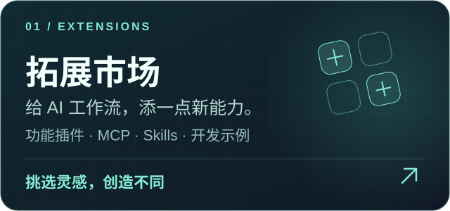
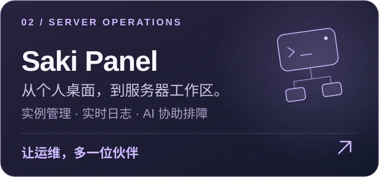

<div align="center">

# Saki AI Agent

右上角导出菜单支持 Markdown、PDF 和 PNG 图片。导出按 User/Assistant 顺序排版，保留正文、代码、表格和图片，不包含聊天界面按钮或内部推理。PDF 保留可选取文字并嵌入图片，适合阅读及交给支持 PDF 的 AI；Markdown 保留图片链接（本地链接需要原服务可访问）。PDF/PNG 需要本机安装 Chrome 或 Edge；图片无法读取时会明确报错，不会静默丢图。过长对话请优先使用 PDF 或 Markdown。

联网搜索无需手动开启：Agent 会根据时效信息、外部资料和事实核查需求自主调用搜索；普通回答无需强制联网。聊天和托管任务中的联网搜索开关已移除，旧开关值不再限制 Agent 搜索能力。“深度研究”仍作为生成综合研究报告的独立模式保留。

在聊天输入框输入 `@` 可选择本条消息使用的 MCP 服务或已启用的 Skill，支持重复输入 `@` 多选、方向键导航、Enter/Tab 确认和 Escape 关闭。选择会插入 `@mcp:服务ID` 或 `@skill:技能ID`，删除对应标记即可取消选择。选择随消息保存，队列编辑和重试会保留；下一条消息不自动继承。含选择标记的消息使用 Agent 模式，而非深度研究、PPT 等专用模式。未选择的 MCP 工具不会注册到本轮，Skills 不再自动匹配注入；原 MCP 总开关不再启用全部服务。托管任务可在任务文本中使用相同标记。
### 本地优先的 AI 工作区：代码、文件、研究与长期协作

Local-first AI Workspace · Model Choice · Recoverable Workflows · Beyond Coding

[English](README.md) · **简体中文**

</div>

<div align="center">

[](https://nodejs.org/)
[](https://reactjs.org/)
[](https://vitejs.dev/)
[](https://tailwindcss.com/)
[](https://expressjs.com/)
[](LICENSE)
[](#参与贡献)

</div>

**Saki AI 是面向中文用户、本地优先的 AI 工作区。** 在一个图形界面中连接本地或云端模型，让 Agent 处理项目代码、工作区文件和终端任务，并把研究、文档、PPT、长期记忆与 QQ 工作流整合到日常协作中。

以 **Codex、Claude Code 等编程智能体**所代表的任务式协作为参照，Saki 的重点不是宣称编程能力超越它们，而是提供一个**不绑定单一模型、覆盖编程之外场景、可在本机管理和回退任务的个人 AI 工作区**。当前界面由本地 Web 服务提供；Windows 便携版通过 EXE 启动服务并打开浏览器，并非原生桌面 GUI。

**[下载 Windows 便携版](https://github.com/EthanChan050430/Saki-AI/releases/latest)** · [快速开始](#快速开始) · [低资源部署](docs/deployment.md) · [插件说明](docs/plugin-marketplace.md)

> **关键词**：Desktop AI Agent · Coding Agent · Local-first · Ollama / LM Studio · MCP · 工作区检查点 · 长期记忆 · 中文研究与办公


https://github.com/user-attachments/assets/91ac7121-2a01-4751-a0c3-bc257e097b0e

## 小模型 Agent 提示词与记忆证据

Ollama / LM Studio 默认开启 `promptSlimming`（可在配置中设为 `false` 回到完整提示词）。精简模式采用行动—观察—验证循环：依赖前一步结果的工具必须等待观察，不要求输出冗长 Thought，保留权限、文件哈希与验证约束。原生工具不受模型支持时，Ollama 重试会同步切换为文本工具协议。

精简模式的记忆注入保留原有相关性过滤，再从已召回记录的正文选择与问题匹配的片段，带来源 ID，以 JSON 数据记录注入并进行精确文本去重。预算不超过估算上下文的 18% 或 1400 个估算 token（取较小值）；这不是模型 tokenizer 的精确计数。长记录只展示片段，模型应通过 `readMemory` 获取全文；旧事实需要核验。此优化不改变存储、写入权限和完整模式，也不等于完整文档级 RAG 重构。数据边界和提示词不能保证彻底防住提示注入。

删除工具区分文件和目录：`deleteFile(path, expectedHash)` 只处理普通文本文件；`deleteDirectory(path)` 将目录及内容移入应用回收站，所有权限模式均需确认本次具体路径，可从文件管理器的回收站恢复。默认权限仍限制在工作区，并拒绝包含敏感路径的目录；根目录、工作区本身、用户主目录、项目目录及其祖先、链接/联接路径均禁止删除。默认权限下目录检查最多 10000 个条目，超过时需缩小范围。

回归测试覆盖中文片段选择、来源标识、预算、去重与工具解析边界；这些是工程可靠性检查，不代表已经证明 4–12B 模型的端到端成功率提升或达到大模型水平。

## 看见 Saki

设置中的每个聊天服务商（包括 Ollama、LM Studio、GitHub 和各 API）都有独立启用开关。填写或清空 API Key 不会改变开关；关闭后保留凭据，停止获取并隐藏其模型，当前服务商关闭后需重新开启才能发送聊天。旧配置首次迁移保留当前服务商与 Ollama 开启，其余默认关闭，不按已保存密钥自动启用。“主页列出全部已启用 API 模型”仍只控制是否同时展示其它已开启 API 的目录。

模型目录在配置加载后获取，并在页面可见时每分钟刷新；返回窗口、页面重新可见或网络恢复也会触发刷新。同一轮请求不会重叠。成功获取的服务商目录替换旧缓存（包括空目录），失败时保留该服务商缓存并记录错误，不再用固定的 GitHub 模型名单冒充实时结果。当前选中的手动模型仍保留为 `(current)`，不会因目录刷新被自动移除。修改服务商地址或凭据后会重新获取目录。

把灵感、模型与工具，放进属于你的工作区。


用功能插件、MCP 工具与专属 Skills，拓展日常工作流。


## 从桌面出发，继续探索

给 AI 工作流添一点新能力，也把视野延伸到服务器。沿着这两个入口，发现 Saki 的更多可能。

<table>
  <tr>
    <td width="50%" valign="top">
      <a href="https://github.com/EthanChan050430/saki-plugins"></a>
      <p>发现功能插件、MCP 工具与 Skills，为日常任务拓展能力。Saki AI 的插件市场可直接下载安装仓库中的功能插件，也可以从示例开始开发自己的插件。</p>
      <p><a href="https://github.com/EthanChan050430/saki-plugins"><strong>逛逛拓展市场 · 查看仓库 ↗</strong></a></p>
    </td>
    <td width="50%" valign="top">
      <a href="https://github.com/EthanChan050430/Saki-Panel"></a>
      <p>从个人桌面走向服务器工作区。在一个 Web 控制台管理 Minecraft、Steam、Docker 与常规进程，让 Saki 结合日志、文件和节点指标协助排障。</p>
      <p><a href="https://github.com/EthanChan050430/Saki-Panel"><strong>认识 Saki Panel · 查看仓库 ↗</strong></a></p>
    </td>
  </tr>
</table>

## 能做什么

- **模型随便换**：Ollama、LM Studio，OpenAI、Anthropic、Gemini、DeepSeek、智谱、Kimi、通义、豆包、MiniMax，或任何 OpenAI 兼容接口。密钥按渠道分开存，顶部一键切换。
- **直接上手干活**：读写项目文件、执行终端命令，每次工具调用和代码改动都摆在界面上。
- **改坏了能退**：每轮任务开始前自动给工作区拍快照，终端里的增删改也算在内。点一下回到任意一轮，不用 Git。
- **跑着也能插话**：任务执行中随时补充要求，后续需求排队，可改可撤。
- **记得住你**：跨会话长期记忆，偏好和项目约定不用每次重讲。
- **写代码之外**：PDF / Office 文档问答、多来源深度研究、PPT 生成与导出、声明核查。

PPT 完成后可在页面预览下输入修改要求，仅重做当前页，其他页面保持不变；支持恢复上一版，每页最多保留最近 10 次修改。修改通过聊天记录保存，保存失败会显示错误并恢复原稿。新生成的演示稿共享统一视觉指导，旧稿修改则沿用当前页风格。修改后请使用 PPT 面板重新导出，旧的自动生成附件不再显示。普通 PPTX 优先保持外观，可编辑 PPTX 便于后续修改，复杂效果可能有所简化；主题指导并不保证像素级一致性。

**PPT AI 配图**：先在设置中配置 Stable Diffusion 或 Custom Drawing API。在已完成的页面点击「预留右侧配图位置」，模型会调整该页布局；检查文字与图片占位区域后，填写不含敏感信息的图片描述，勾选费用与发送确认，再点击「生成 / 替换配图」。当前版本操作该页第一个图片槽位，一次生成一张，替换时保留槽位尺寸和页面文字；「恢复上一版」恢复整页快照。生图服务只收到图片描述与构图要求，不收到原稿或参考图；预留布局仍使用当前聊天模型处理该页内容。

生成图片保存为本地素材，并以内嵌图片形式随页面保存，避免临时链接过期；因此聊天记录体积会增加。槽位需使用明确的像素坐标，且位于 960×540 画布内。当前默认右侧槽位为 `(520,120,380,300)`，完整显示图片；暂不提供裁切焦点编辑、自动图文重叠检测或整稿自动配图。普通及可编辑 PPTX 沿用面板导出流程。

同一请求在当前后端进程内去重，失败不会自动重新生图（包括尺寸降级重试）；进程最多保留 100 个请求。去重记录尚未跨重启持久化，刷新页面或重启后端后不要直接重复提交超时任务，应先向服务商确认任务和扣费状态。费用由所配置的服务商决定，目前不提供精确报价。验证使用模拟生图结果、浏览器坐标检查及 PPTX 构建器，不会在测试中调用收费生图服务。
- **故事酒杯**：给 Saki 讲个故事，她会调一杯属于这个故事的鸡尾酒，生成可分享的卡片。
- **能扩展**：MCP、Skills、插件市场；可接 QQ 机器人、Stable Diffusion 绘图、GPT-SoVITS 语音。
- **按需绘图**：在设置中配置绘图服务后，直接描述想生成的图片，Agent 会按请求决定是否调用绘图工具，无需开启“智能绘图”开关；也可使用 `/image` 快捷输入绘图请求。
- **够轻**：生产模式一个进程一个端口，数据存本地 JSON，不用装数据库。

## 快速开始

**Windows 便携版**：下载 `Saki-AI-3.0-win-x64.zip`，解压后双击 `Saki-AI.exe`，浏览器会打开 http://127.0.0.1:5480 ，在设置里填好模型即可。已内置 Node.js。

**源码运行**（Windows / macOS / Linux，需要 Node.js 22.12+）：

```bash
git clone https://github.com/EthanChan050430/Saki-AI.git
cd Saki-AI
node scripts/launch.cjs
```

首次启动会自动安装依赖并构建前端。macOS / Linux 后台运行用 `bash deploy.sh start`，低配机器部署看 [低资源部署指南](docs/deployment.md)。

## 注意

权限审批和路径检查是应用层防护，不是系统级沙箱。终端命令和第三方插件以当前用户权限运行，只授权需要的目录。检查点只回滚工作区文件，已经发出去的请求和消息撤不回来。

## 参与贡献

欢迎提 Issue 和 PR。许可证：[Apache 2.0](LICENSE)。
