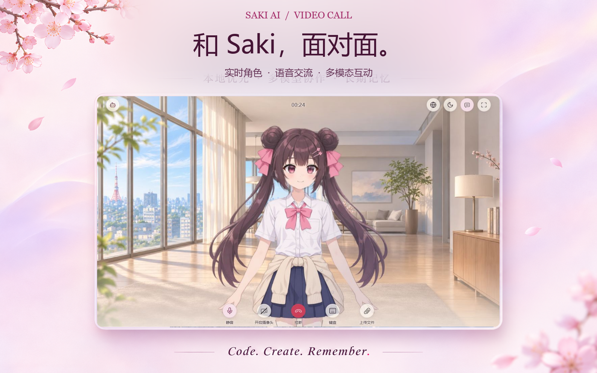
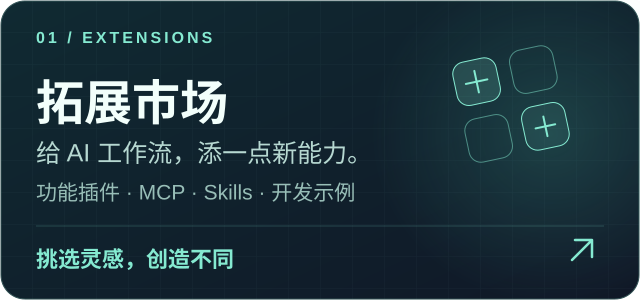
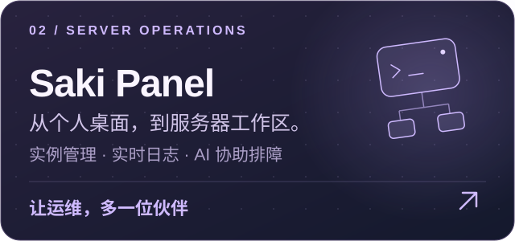

<div align="center">

# Saki AI
### 开源、本地优先的个人 AI Agent 工作区

支持本地与云端多模型 · 读写代码与终端 · 自动快照回滚 · MCP 与插件扩展

[English](README.md) · **简体中文**

</div>

<div align="center">

[](https://nodejs.org/)
[](https://reactjs.org/)
[](https://vitejs.dev/)
[](https://tailwindcss.com/)
[](https://expressjs.com/)
[](LICENSE)
[](#参与贡献)

</div>

**Saki AI 是一个运行在你自己电脑上的开源 AI Agent 工作区。** 它把本地大模型（Ollama、LM Studio）和主流云端模型（DeepSeek、Claude、OpenAI、Gemini、通义、Kimi 等）放进同一个可视化界面，直接帮你改代码、管文件、跑终端命令、做深度研究、生成 PPT 和处理日常文档。

如果你喜欢 **Claude Code、Codex** 这类 Agent 直接下场干活的协作方式，但希望**有图形界面、不绑定单一模型、改坏了能随时一键回滚（无需 Git），并且能处理写代码之外的办公与研究任务**——Saki 就是为此设计的。

**[下载 Windows 便携版](https://github.com/EthanChan050430/Saki-AI/releases/latest)** · [快速开始](#快速开始) · [低资源部署](docs/deployment.md) · [插件市场](docs/plugin-marketplace.md)

https://github.com/user-attachments/assets/283a9c57-3d0d-473e-bba6-f1969d2420b1

## 界面预览

**多模型工作区**：读写本地文件、执行终端、查看代码 Diff，支持跨会话长期记忆。


**插件市场与 MCP 扩展**：一键安装功能插件、MCP 工具与专属 Skills。


**实时角色视频通话**：支持语音对话、实时字幕与摄像头视觉输入。


## 生态与衍生项目

<table>
  <tr>
    <td width="50%" valign="top">
      <a href="https://github.com/EthanChan050430/saki-plugins"></a>
      <p>在 Saki 内置插件市场直接下载安装插件，或基于示例快速开发你自己的插件与 Skills。</p>
      <p><a href="https://github.com/EthanChan050430/saki-plugins"><strong>浏览 saki-plugins 仓库 ↗</strong></a></p>
    </td>
    <td width="50%" valign="top">
      <a href="https://github.com/EthanChan050430/Saki-Panel"></a>
      <p>带 AI 助手的开源服务器面板。在 Web 控制台管理 Minecraft、Steam、Docker 与常规进程，结合日志与监控指标辅助排障。</p>
      <p><a href="https://github.com/EthanChan050430/Saki-Panel"><strong>了解 Saki Panel ↗</strong></a></p>
    </td>
  </tr>
</table>

## 能做什么

- **模型随便换**：Ollama、LM Studio，OpenAI、Anthropic、Gemini、DeepSeek、智谱、Kimi、通义、豆包、MiniMax，或任何 OpenAI 兼容接口。密钥按渠道分开存，顶部一键切换。
- **直接上手干活**：读写项目文件、执行终端命令，每次工具调用和代码改动都摆在界面上。
- **改坏了能退**：每轮任务开始前自动给工作区拍快照，终端里的增删改也算在内。点一下回到任意一轮，不用 Git。
- **跑着也能插话**：任务执行中随时补充要求，后续需求排队，可改可撤。
- **视频通话**：与实时角色语音交流，支持字幕和可选的摄像头输入。详见[视频通话说明](docs/video-call.md)。
- **记得住你**：跨会话长期记忆，偏好和项目约定不用每次重讲。
- **写代码之外**：PDF / Office 文档问答、多来源深度研究、PPT 生成与导出、声明核查。
- **故事酒杯**：给 Saki 讲个故事，她会调一杯属于这个故事的鸡尾酒，生成可分享的卡片。
- **能扩展**：MCP、Skills、插件市场；可接 QQ 机器人、Stable Diffusion 绘图、GPT-SoVITS 语音。
- **够轻**：基于本地 Web 服务架构，生产模式一个进程一个端口，数据存本地 JSON，不用装数据库；Windows 便携版内置 Node.js，解压双击即用并自动打开浏览器。

## 快速开始

**Windows 便携版**：下载 `Saki-AI-3.0-win-x64.zip`，解压后双击 `Saki-AI.exe`，浏览器会打开 http://127.0.0.1:5480 ，在设置里填好模型即可。已内置 Node.js。

**源码运行**（Windows / macOS / Linux，需要 Node.js 22.12+）：

```bash
git clone https://github.com/EthanChan050430/Saki-AI.git
cd Saki-AI
node scripts/launch.cjs
```

首次启动会自动安装依赖并构建前端。macOS / Linux 后台运行用 `bash deploy.sh start`，低配机器部署看 [低资源部署指南](docs/deployment.md)。

## 注意

权限审批和路径检查是应用层防护，不是系统级沙箱。终端命令和第三方插件以当前用户权限运行，只授权需要的目录。检查点只回滚工作区文件，已经发出去的请求和消息撤不回来。

## 参与贡献

欢迎提 Issue 和 PR。许可证：[Apache 2.0](LICENSE)。
